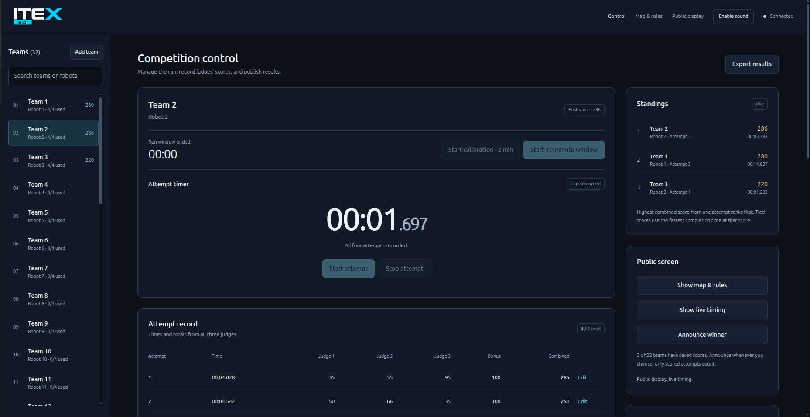
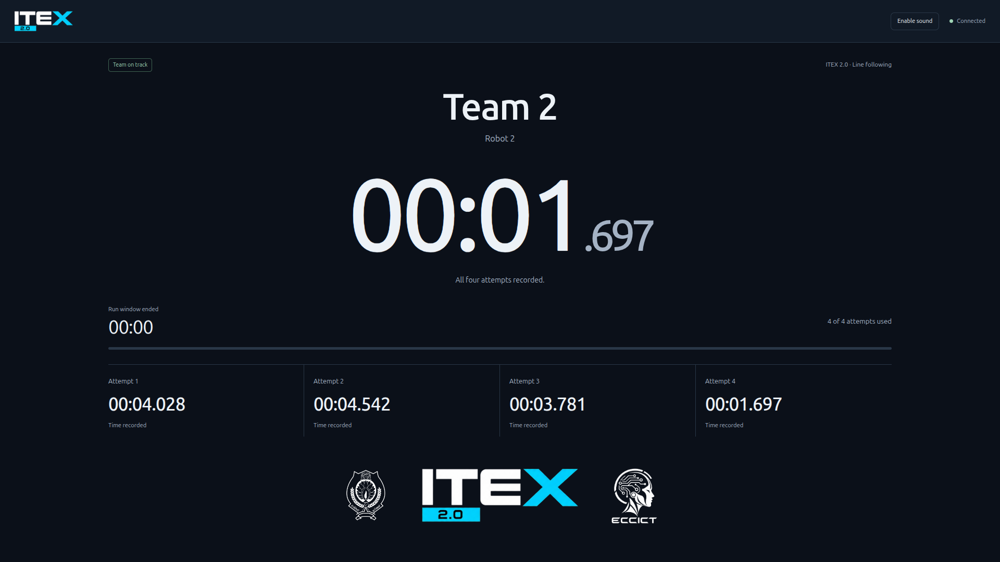

# ITEX 2.0 competition dashboard

Run `npm install` then `npm start` (Node.js 20 or newer). Open `/admin` for competition control, `/coordinator` for staff score review, `/display` for the audience screen, and `/rules` for the course briefing. All screens must use the same server address; use the server computer’s LAN address from other devices. This is a trusted-LAN event tool; the control panel has no login.

## Interface Preview

### Admin Control Panel (`/admin`)
Full competition management interface for judges and operators: team selection, run window and calibration timing, attempt records, judges' score inputs, live standings, and winner announcements.

### Public Audience Display (`/display`)
Live audience-facing screen designed for stage projection: shows active team details, real-time attempt countdown, attempt history, competition course layout, and sponsor branding.

## Coordinator review (`/coordinator`)

Use **Coordinator review** in the control panel navigation or on the home page. Coordinators see every team in running order, all recorded attempts, each judge’s marks, the completion bonus, combined totals, and recorded times. The panel includes live Standings and highlights each team’s best attempt, score and time. During rounds, coordinators can view marks only. **Review / edit** unlocks after all four attempts have stopped, or the run window ends, and judges have saved marks for every recorded attempt. Coordinators can then correct saved marks, completion and times; only judges in competition control can enter the original marks. Corrections update the admin panel and standings immediately. Reviewing another team does not change the team selected at competition control or interrupt a running timer. Concurrent corrections are checked against the attempt revision; stale saves are rejected.

Coordinator connections accept eligible corrections only; roster, timer, reset and display actions remain in competition control. Like the existing admin panel, this is a trusted-LAN staff screen without login, not an authentication boundary. Audience displays receive timing and team order without marks.

Fresh competitions and full roster resets use five teams. An untouched legacy 32-team placeholder roster is reduced automatically on startup; saved names, timers and scores are preserved when existing event data is present. Use the existing explicit full reset only when you intend to clear that data.

## Competition workflow

1. Select a team. Start with five placeholder teams. Rename them or add more teams as needed; no robot name is required. Before any calibration or run begins, click **Shuffle team order** to draw the running order. An animated reveal shows the draw, and both staff panels adopt the same order. The order survives restarts; newly added teams appear at the end.
2. Start the optional two-minute calibration. It is available once per team, before the run window. Pause or resume calibration at any time, or choose **Finish calibration** to end it early. You can start the run window early if calibration finishes early.
3. Start the ten-minute run window. **Pause run window** freezes both the window and an active attempt; **Resume run window** continues with the remaining time. **End run window** ends it early and forfeits unused attempts. The window cannot be restarted; calibration expiry does **not** start it automatically.
4. Start and stop each robot attempt. Each start uses one of four attempts. Between attempts the ten-minute window keeps running unless explicitly paused by the judge. At expiry, an active attempt stops automatically and is marked incomplete pending judges’ scores.
5. Enter all three judges’ totals and indicate whether the course was completed. Each stopped attempt immediately stores its time, so you can run all four attempts before entering any marks. The **Judges’ marks** area below the attempt record has a separate form for every stopped attempt; enter and save marks in any order. Zero is a valid score. No section-by-section entry is required. Use the form for that attempt to correct a saved score, completion status, or recorded time.
6. Use **Show team list on display** to show the running order to participants, then open **Public display**. Its **Shuffle team order** button draws a shared order with animation before calibration or competition starts. Display connections can perform this shuffle only while the team list is shown; other competition controls remain unavailable. Use **Show map & rules** for the team briefing, or **Show live timing** during the competition. Timers continue in either display view unless paused. The public screen shows a large attempt timer and all four attempt times, with no marks or score-based standings. Judge totals, combined scores, and rankings are excluded from audience WebSocket messages, including the winner announcement; winner names are shown only when announced. The trusted-LAN admin/API remain unauthenticated, so this is display separation rather than access control.
7. Announce the winner whenever you choose, whether 1, 5, 10, or any other number of teams have scored. The result uses all currently saved scores; there is no required team count. Teams and attempts without scores are ignored, and active timers keep running. Continue entering scores and announce again later if needed. Teams without a scored attempt are unranked. Export results downloads a JSON snapshot of every team, attempt, judge total, and session.

Each attempt’s combined score is **Judge 1 + Judge 2 + Judge 3 + a 100-mark bonus for completing the entire challenge**. In the judging form, check **Entire challenge completed (+100 bonus marks)** to award the bonus once for that attempt. Completion is not selected automatically when the timer stops. The bonus is shown separately from judge totals and is recalculated when completion is corrected. Previously saved completed attempts are updated to include the bonus when the database is loaded; any affected winner announcement is cleared for review. A team’s highest combined attempt score is used for ranking. Ties compare the shortest **completion time among attempts at that highest score**. A faster attempt with lower marks does not affect the tie-break. Incomplete attempts retain their marks but have no eligible completion time; a completed attempt wins a score tie against an incomplete attempt. Exact score-and-time ties share the rank and can produce shared first place.

## Display branding and sounds

The public display uses an ITEX-only header. The school logo, a larger ITEX logo, and the ICT Society logo sit below the recorded times and fill the available screen height.

Click **Enable sound** on each screen where you want audio. Browsers require this click before audio playback. Short tones indicate start/resume, pause, stop, and timer expiry. During the final ten seconds of calibration or the run window, one click sounds per second and the timer blinks red. Pausing freezes the warning; muting leaves the visual warning active. With reduced motion enabled, the warning stays steadily red. Background tabs do not play sounds. Use **Sound on** to mute. Audio is synthesized locally and requires no external files or network access.

## Changing display logo sizes and gaps

Edit `public/display-settings.css` and refresh `/display`. The commented variables at the top control the large-screen layout. Separate blocks below override sizes for short desktop screens and phones.

- `--display-itex-width`: center ITEX logo width.
- `--display-school-height` and `--display-society-height`: individual side-logo heights.
- `--display-logo-row-width`: overall logo-row width; reduce this to bring the school and society logos closer to ITEX.
- `--display-logo-gap`: minimum horizontal space between logos.
- `--display-logo-top-gap`: space above the logos within their row. The row also uses available screen height to stay near the bottom.
- `--display-logo-bottom-gap`: padding below the logos.
- `--display-header-logo-width`: ITEX logo in the top navigation.

## Reset controls

In **Edit selected team**, **Reset team data** clears that team’s attempts, judge marks, calibration, and run timers while retaining its team name. It stops any active attempt, makes all four attempts available again, and clears an announced winner.

The **Reset competition** panel clears every team’s attempts, marks, timers, standings, and winner announcement. It keeps team names by default. Check **Also restore the default 5-team roster** to remove custom teams and restore the original team names. Type **RESET ALL** to enable confirmation. Export results first if needed; resets cannot be undone. SQLite saves the reset atomically and connected displays update immediately. Old score submissions from before a reset are rejected.

## SQLite persistence

The database is created automatically at `data/competition.sqlite`. Teams, four attempt records, judge totals, scores, times, calibration/run deadlines, the selected team, and the public display mode survive restarts. Running timers use absolute server deadlines and continue through browser disconnects and server restarts; paused timers keep their remaining time across restarts. An expired active attempt is settled on recovery. A successful save message is sent only after the SQLite transaction commits.

Set `DB_PATH` to override the database location and `PORT` to change the port (default 3000). Back up the database with SQLite’s backup mechanism, or stop the server before copying `data/`; include WAL files if present. Keep the database out of version control. Exported JSON is a portable results snapshot, not a database restore file.

`docker compose up --build -d` runs the dashboard with a named `itex-data` volume at `/app/data`, preserving scores when the container is rebuilt. Do not remove the volume if you need to retain event data.

The source map is `ITEX-Line-Following-Score-Sheet.jpg`; its public copy is `public/assets/competition-map.jpg`.

## Verification

Run `npm test` for scoring, tie-breaks, attempt limits, calibration, deadline expiry, stale edits, and SQLite persistence tests. Run `npm run test:integration` for a real WebSocket and server-restart check using an isolated temporary database on port 3003.

Run `npm run test:audio` for sound-transition and countdown-warning checks.
